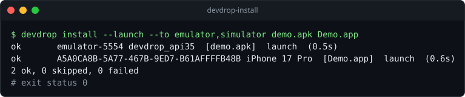
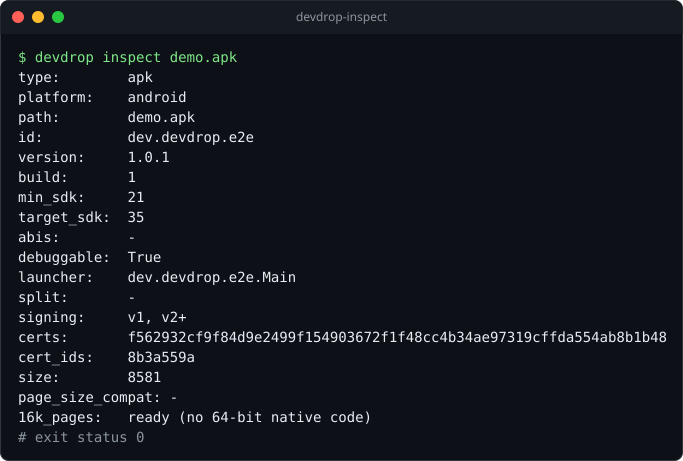

# devdrop

[](https://github.com/jacob-adm/devdrop/releases/latest) [](https://github.com/jacob-adm/devdrop/blob/main/pyproject.toml) [](https://github.com/jacob-adm/devdrop#license)

Install one Android or iOS build on every phone, tablet, emulator and
simulator you have attached, all at once.

devdrop drives the platform tools you already have: `adb` for Android
phones, tablets and emulators, and `xcrun devicectl` / `xcrun simctl` for
iPhones, iPads and iOS simulators. It is a single Python package with no
dependencies.

Status: 0.4.0. Not yet on PyPI. Tested on Android emulators, iOS
simulators and one physical iPhone; not yet on physical Android phones,
tablets or iPads. [Testing](https://github.com/jacob-adm/devdrop/blob/main/docs/testing.md)
lists what was run where, and what was not.

## Example output

One Android build and one iOS build installed and launched together on an Android emulator and
an iPhone simulator; `--to emulator,simulator` leaves physical devices out:

<p align="center"></p>

What `inspect` reads from an APK before anything is installed:

<p align="center"></p>

## Requirements

- Python 3.11 or later
- Android: Android SDK platform-tools (`adb`). devdrop looks in
  `$ANDROID_HOME`, `$ANDROID_SDK_ROOT`, the default SDK location for your
  OS, then `PATH`.
- iOS: macOS with Xcode. Physical devices need Xcode 15 or later
  (`devicectl`); simulators work with any Xcode that has `simctl`.
  Optional: with `pymobiledevice3` on `PATH`, `--logs` and
  `--screenshot` also work on physical iPhones.

Either platform works without the other.

## Install

From a clone of this repository:

```
python3 -m pip install .
```

## How it works

1. **Attach devices.** Plug in phones and tablets over USB, or connect
   Android ones over Wi-Fi (`devdrop pair`, `devdrop connect`) and
   iPhones and iPads through Xcode's network pairing. Start
   emulators and simulators yourself, or let devdrop start them with
   `--boot`. The first time, an Android phone asks to allow USB debugging
   and an iPhone needs Developer Mode on and to trust the computer.
   `devdrop devices` lists everything; only devices shown as `ready`
   get installs.
2. **Run `devdrop install app.apk`** (or `.aab`, `.ipa`, `.app`). devdrop
   reads the build first. An Android build goes to the Android devices,
   an iOS build to the iOS ones. `--to` narrows the list.
3. **Devices that can't take the build are skipped**, each with a reason:
   Android too old for the app, no native code for that CPU, a simulator
   build sent to an iPhone, a provisioning profile that doesn't list
   that iPhone, and so on. Nothing is sent to them.
4. **The rest install at the same time.** The run takes about as long as
   the slowest device. Measured with test apps of about 100 KB, three
   runs each: 0.2 to 0.9 s on an Android emulator, 1.0 to 3.6 s on an
   iPhone over USB, and 0.3 s on an iOS simulator (7 s for the first
   install after the simulator boots). A real app takes longer.
5. **Optionally, launch.** `--launch` opens the app on each device. Add
   `--logs DIR` and devdrop watches each app for 5 seconds: an app that
   crashed is marked failed with the crash's cause, and each Android
   device's and simulator's log is saved. On an iPhone it checks that
   the app is still running. Add `--screenshot DIR` and it saves what
   each Android device and simulator shows a few seconds after launch.
   A physical iPhone's log and screenshot need the optional
   pymobiledevice3 tool.
6. **Read the result.** One line per device: `ok`, `skipped` or `failed`,
   with the reason. The exit code is 0 only when every device is `ok`.
   `--json` and `--junit FILE` give the same results to scripts and CI.

iPhones have a few rules of their own (Developer Mode, trusting a new
developer, 7-day builds on a free account): see
[Physical iPhones](https://github.com/jacob-adm/devdrop/blob/main/docs/devices.md#physical-iphones).

## Commands

```
devdrop devices [--json] [--all] [--to SEL]   list attached devices and their state
devdrop doctor                     check the toolchain; say what to fix on each device
devdrop inspect PATH [--json]      show what an .apk, .aab, .ipa or .app contains
devdrop install PATH [PATH] [--to SEL] [--launch] [--clean] [--dry-run] [--jobs N] [--json]
                [--ks KEYSTORE --ks-alias ALIAS]      (.aab only)
                [--logs DIR [--log-seconds N]] [--watch [--watch-timeout S]]
                [--screenshot DIR [--screenshot-seconds N]] [--url URL]
devdrop launch APP_ID [--to SEL] [--logs DIR [--log-seconds N]] [--jobs N] [--json]
                [--screenshot DIR [--screenshot-seconds N]] [--url URL]
devdrop uninstall APP_ID [--to SEL] [--jobs N] [--json]
devdrop pair HOST:PORT CODE        pair with an Android device over Wi-Fi
devdrop connect [HOST:PORT ...]    connect over Wi-Fi (default: every paired device found by mDNS)
devdrop boot --to SEL [--show] [--boot-timeout S] [--json]
devdrop shutdown [--to SEL] [--json]
```

See [Commands](https://github.com/jacob-adm/devdrop/blob/main/docs/commands.md) for what each one does and checks.

## Quick start

```
devdrop devices                          # what is attached, and what is ready
devdrop install app.apk --launch         # every ready Android device at once
devdrop install app.ipa --to physical    # iPhones and iPads only
devdrop install app.apk app.ipa          # both builds of a release, one report
devdrop boot --to my_avd                 # start a stopped emulator by name
```

## Documentation

- [Commands](https://github.com/jacob-adm/devdrop/blob/main/docs/commands.md): each command, what `install` checks
  before it touches a device, launch logs, App Bundles, settings and exit codes.
- [Devices](https://github.com/jacob-adm/devdrop/blob/main/docs/devices.md): choosing devices with `--to`, naming them,
  Wi-Fi, emulators and simulators, and physical iPhones.
- [Reports for CI](https://github.com/jacob-adm/devdrop/blob/main/docs/ci.md): JSON and JUnit output.
- [JSON output](https://github.com/jacob-adm/devdrop/blob/main/docs/json.md): every `--json` field, what stays
  stable, and use from a script or a coding agent.
- [Testing](https://github.com/jacob-adm/devdrop/blob/main/docs/testing.md): the unit and end-to-end suites, and the
  devices devdrop has been tested on.
- [Security](https://github.com/jacob-adm/devdrop/blob/main/SECURITY.md): what devdrop runs, what it guards against, and how to
  report a vulnerability.
- [Contributing](https://github.com/jacob-adm/devdrop/blob/main/CONTRIBUTING.md): tests and how changes reach `main`.
- [Changelog](https://github.com/jacob-adm/devdrop/blob/main/CHANGELOG.md)

## License

Apache-2.0
